# Personal Wellness Hub

A web application where users register, log in and track their daily wellness: exercise, sleep, water, meditation and mood. Built for the EE4207 Web Application Development mini project.

## Features
- Register, log in and log out (passwords are hashed)
- Add, view, edit and delete wellness logs (each user sees only their own)
- Search, filter by category and sort the logs
- Dashboard with totals, 7-day insights, weekly chart and wellness tips
- Form validation on the browser and the server
- Responsive layout that adjusts to phone and tablet screens

## Tech Stack
Node.js, Express, MySQL, HTML, CSS and JavaScript

## Database
Tables: `users`, `categories`, `wellness_logs` and `goals`.
One user has many logs, and one category has many logs.

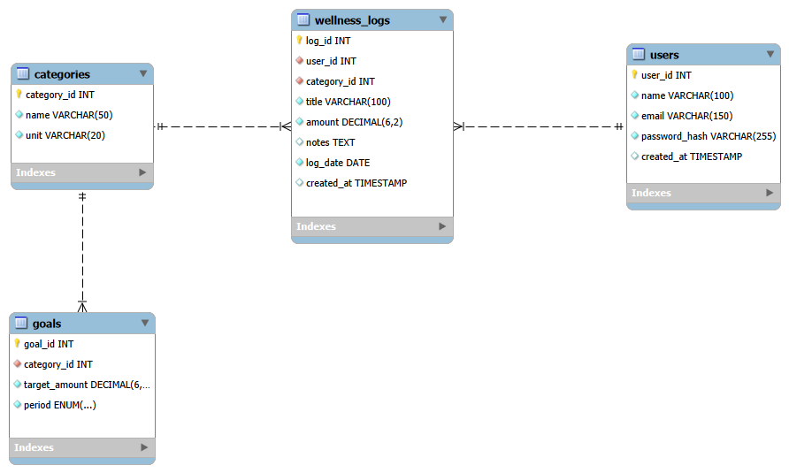

## Setup
1. Clone the project and open the folder:
   ```
   git clone https://github.com/arunodijayasinghe/personal-wellness-hub.git
   cd personal-wellness-hub
   ```
2. Install the packages:
   ```
   npm install
   ```
3. Open `database/schema.sql` in MySQL Workbench and run it.
4. Copy `.env.example` to a new file named `.env` and fill in your MySQL user, password and a long random `SESSION_SECRET`.
5. Start the server:
   ```
   npm start
   ```
6. Open http://localhost:3000/login.html

## Screenshots

### Login and register
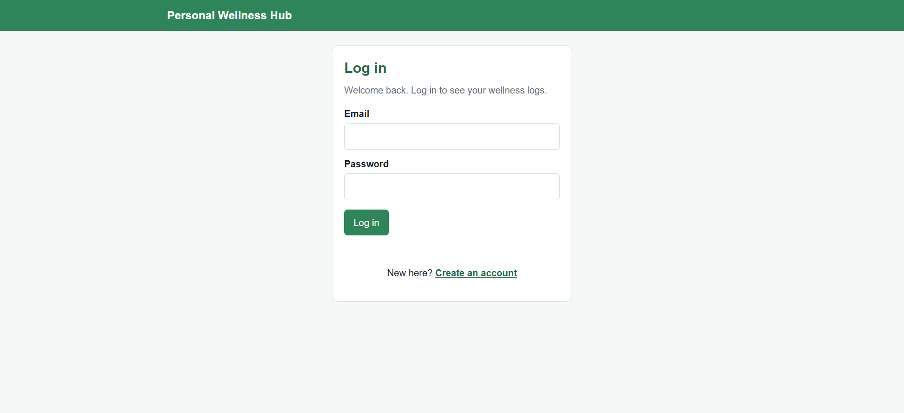
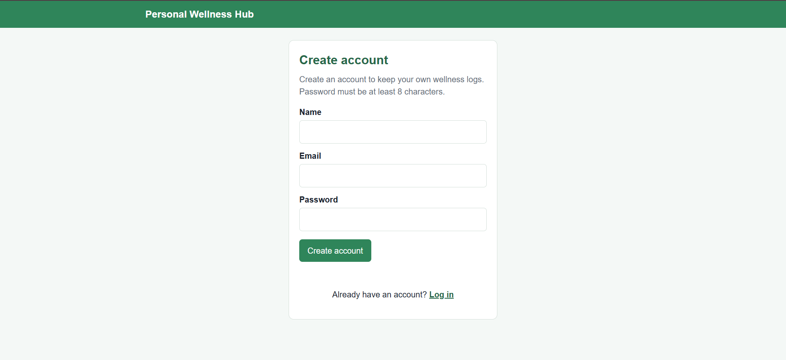

### Dashboard
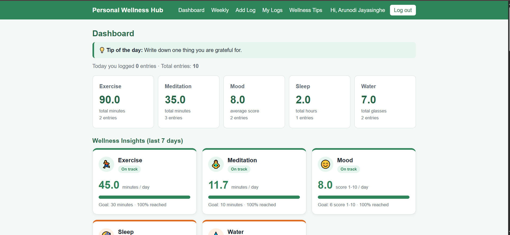
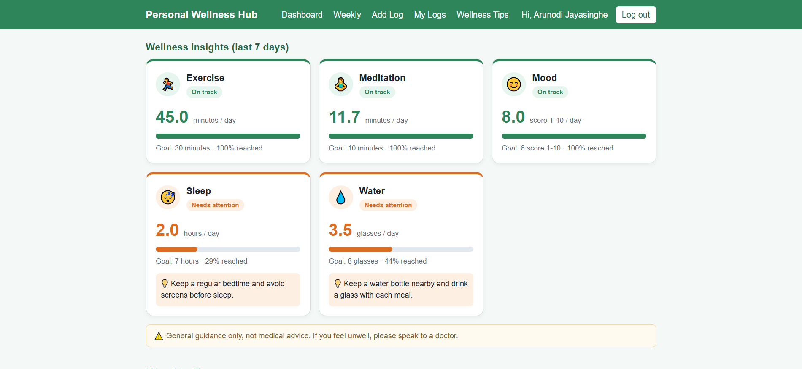

### Weekly report
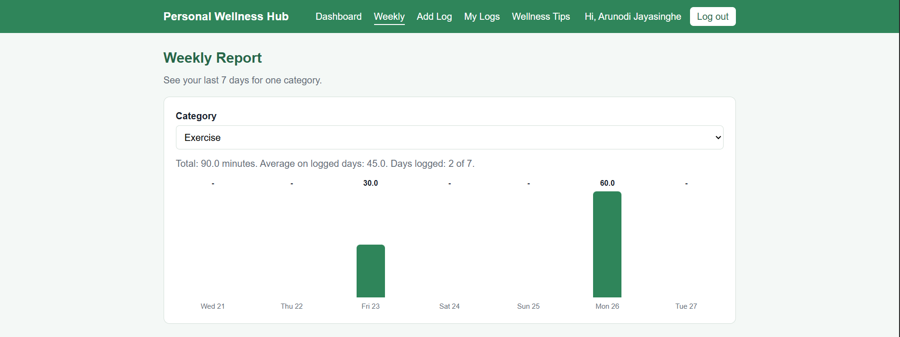

### Add, view and edit logs
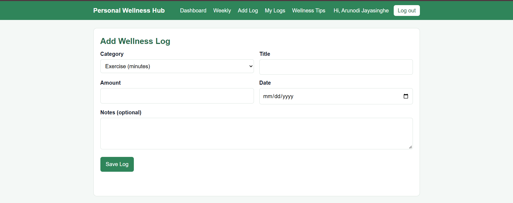
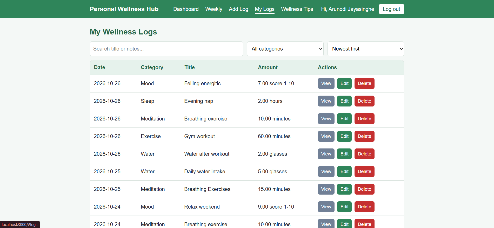
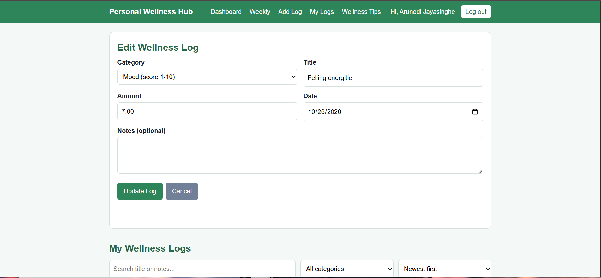

### Validation
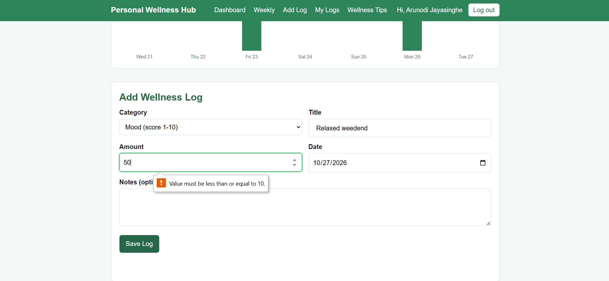
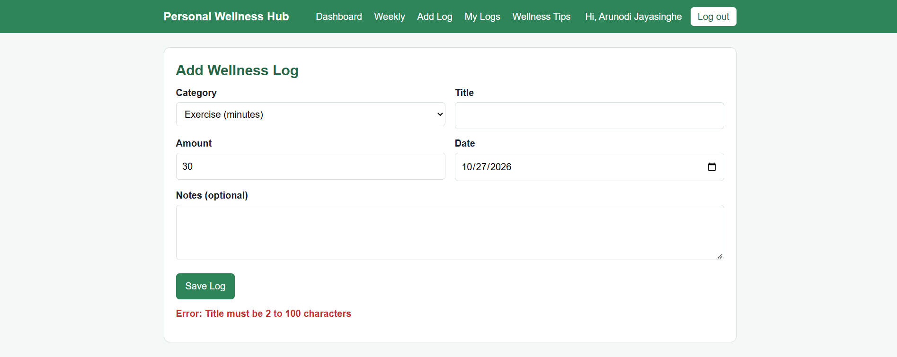

### Mobile view
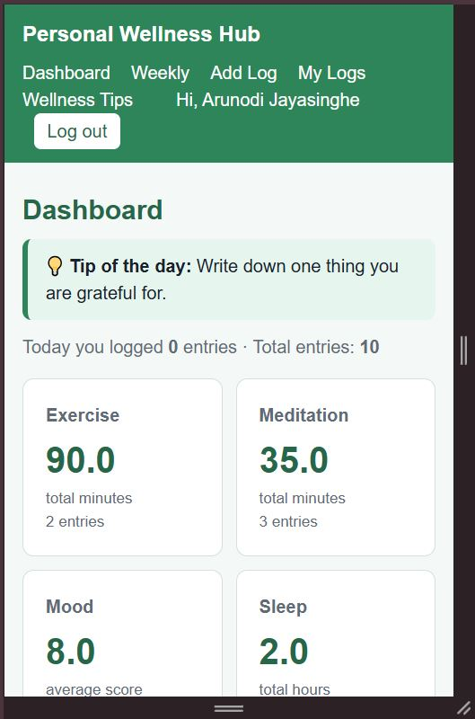
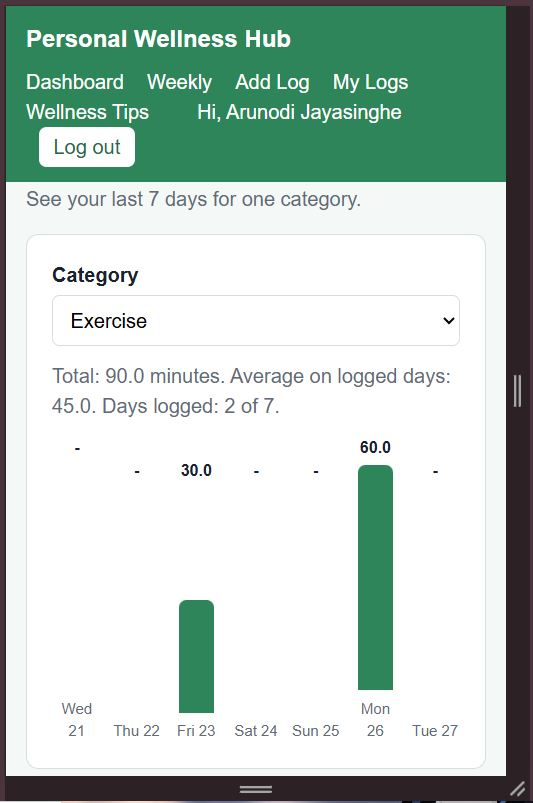

## Limitations
- Users must log in again after the server restarts
- Goals are shared by all users and cannot be edited in the app
- There is no password reset
- Tips and goals are general guidance, not medical advice

## Author
Jayasinghe J.D.A.P. , EG/2023/5660